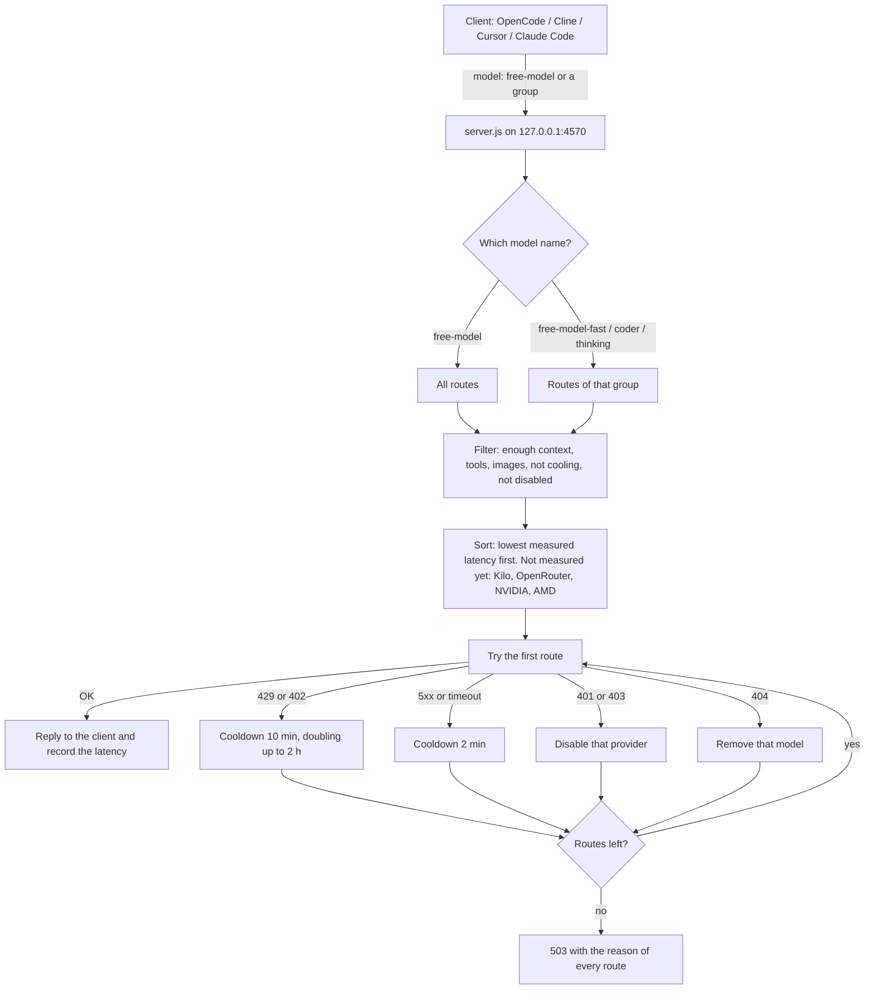

# my-ai-free-model

一個本機端點、一個模型名 —— `free-model` —— 喺背後幫你嘅 coding agent 喺多個免費 LLM 服務之間自動揀路，邊個俾人限流咗就即刻轉去下一個。

[English](../README.md) | [繁體中文（台灣）](./README.zh-TW.md) | 繁體中文（香港／廣東話） | [简体中文](./README.zh-CN.md)

> **狀態：✅ 可以用。** 步驟 0–4 已完成：服務發現、有 failover 同冷卻嘅路由器、兼容 OpenAI 嘅 `/v1/chat/completions`，同兼容 Anthropic 嘅 `/v1/messages`（已用 curl 同 Claude Code 測試）。步驟 5（OpenCode CLI 後備）暫時跳過。

## 點解要整呢個

免費 LLM 額度睇落好正，實際用起上嚟好煩：

- **限流會喺你做緊嘢嗰陣打斷你。** 每個服務喺唔同時間回 429，每日上限都唔同。
- **免費清單成日變。** 模型會冒出嚟、過期（有啲免費模型有 `expiration_date`）或者改名。
- **每個服務都有自己嘅 base URL、key 同模型 ID。** 你個 agent 根本唔應該理呢啲。

將支援 OpenAI 或者 Anthropic 格式嘅工具（OpenCode、Cline、Cursor、Claude Code……）指去 `localhost`，叫佢用 `free-model`。個代理會揀依家用得嘅免費模型，邊個服務出事就轉去下一個。

## 運作方式

```
你嘅工具（model: free-model）
        │
        ▼
 server.js  (127.0.0.1:4570)
   ├─ POST /v1/chat/completions   OpenAI 格式，支援串流同 tool calling
   ├─ POST /v1/messages           Anthropic 格式（自動轉換）
   ├─ GET  /v1/models             列出 "free-model" 同各個分組
   ├─ GET  /status                每條路線嘅延遲同冷卻狀態
   └─ GET  /docs  Swagger 介面 · /openapi.json  OpenAPI 規格
        │
        ▼
 router.js  → 優先用最快嘅路線，失敗就冷卻
        │
        ▼
 providers/  kilo · openrouter · nvidia · amd · opencode-cli
```

### 請求流程



**邊個服務先用？** 冇固定次序。程式按真實請求量度到嘅延遲，最快嗰條路線先用。未有量度數據之前，同速就按 Kilo → OpenRouter → NVIDIA → AMD。所以頭幾次請求可能落喺任何一個服務，之後就會跟速度排序。失敗嘅路線會暫時跳過（冷卻），自動試下一條。

## 服務一覽

| 服務 | Key | 點樣揀免費模型 | 已知限制 | 驗證結果（2026-10-23） |
| --- | --- | --- | --- | --- |
| Kilo | 唔使 | `isFree` 標記 ＋ 支援 tools ＋ 未過期 | 上游可能會記錄 prompt（Kilo 嘅模型卡有寫） | ✅ 清單、傾偈 |
| OpenRouter | `OPENROUTER_API_KEY` | 支援 tools 嘅 `:free` 模型 | 免費模型每日 50 次，儲 $10 或以上有 1000 次（跟 omfm 文檔，未再測） | ✅ 清單、傾偈 |
| NVIDIA | `NVIDIA_API_KEY` | 手動白名單（清單冇免費標記） | 每個模型各有速率限制 | ✅ 清單 · ⏳ 傾偈 |
| AMD | `AMD_API_KEY` | 手動白名單（DeepSeek / MiMo / GLM / Qwen3.8） | 每日 1.0 pt（點數係用量，唔係收費），每分鐘 20 次 | ✅ 清單、傾偈 |
| OpenCode CLI | 唔使 | 已安裝嘅 `opencode` CLI 提供嘅模型 | 最後後備，淨係純文字 | ⏭ |

**關於 OpenCode：** 佢個 gateway 會拒絕直接用 HTTP 打免費額度（`FreeTierError: can only be used from within OpenCode`）。呢個項目唔會扮 OpenCode 客戶端，唯一嘅 OpenCode 路線係叫真正嘅 CLI 做後備。

## 路由規則

- **次序：** 延遲最低嘅先。未有量度數據嗰陣：Kilo → OpenRouter → NVIDIA → AMD → OpenCode CLI。
- **同一個模型喺多個 gateway 出現** 只當一條路線，唔好連續撞同一個後端。
- **Context 檢查：** context 窗口細過 prompt 嘅路線會跳過。
- **淨係喺輸出第一個 byte 之前先會轉路線。** 串流途中出事就直接報錯，唔會靜靜雞重試（免得內容重複）。

| 情況 | 處理 |
| --- | --- |
| 429 / 402 | 冷卻 10 分鐘，再撞就加倍，最多 2 個鐘；偵測到每日額度用晒就冷卻到重置時間 |
| 5xx / 超時 | 冷卻 2 分鐘，試下一條路線 |
| 401 / 403 | 停用呢個服務（key 有問題），並喺 log 提示 |
| 404 model | 將個模型踢出池 |
| 全部失敗 | 回 503，並列出每條路線失敗嘅原因 |

## 安裝設定

需要 Node.js 18 或以上。零依賴，唔使 build。

```bash
git clone https://github.com/<your-user>/my-ai-free-model.git
cd my-ai-free-model
cp .env.example .env      # 然後填返你啲 key
```

`.env`：

```dotenv
PORT=4570
OPENROUTER_API_KEY=
NVIDIA_API_KEY=
AMD_API_KEY=
```

### 攞 API Key

每個 key 填入 `.env`（唔好 commit，已經被 git 忽略）。冇 key 嘅服務會直接跳過。網站介面可能會改，掣名未必一模一樣。

**OpenRouter**（`OPENROUTER_API_KEY`）
1. 登入 [openrouter.ai](https://openrouter.ai)。
2. 打開 [openrouter.ai/settings/keys](https://openrouter.ai/settings/keys) → **Create Key** → 複製（以 `sk-or-` 開頭）。
3. 貼落 `.env` 入面 `OPENROUTER_API_KEY=` 後面。免費模型唔使增值。

**NVIDIA**（`NVIDIA_API_KEY`）
1. 登入 [build.nvidia.com](https://build.nvidia.com)（免費 NVIDIA 開發者帳戶，可能要驗證）。
2. 打開任何一個模型頁 → **Get API Key** → **Generate Key** → 複製（以 `nvapi-` 開頭）。
3. 貼落 `.env` 入面 `NVIDIA_API_KEY=` 後面。

**AMD**（`AMD_API_KEY`）
1. 打開 [developer.amd.com.cn/radeon/profile](https://developer.amd.com.cn/radeon/profile)，登入並領取 API Key。
2. 貼落 `.env` 入面 `AMD_API_KEY=` 後面。
3. 免費額度係每日 1.0 pt、每分鐘 20 次請求。

**Kilo**：唔使 key。

跟住重新行 `node server.js`。啟動時見到 `keys: {"openrouter":true,"nvidia":true,"amd":true}` 代表搵到邊啲 key（唔會印出 key 本身）。

測試啲 key 用唔用得（已經可以用）：

```bash
./scripts/probe-providers.sh >> data/probe-result.txt
tail -40 data/probe-result.txt
```

### 用法

```bash
node server.js

curl http://localhost:4570/v1/models
curl -X POST http://localhost:4570/v1/chat/completions \
  -H "Content-Type: application/json" \
  -d '{"model":"free-model","messages":[{"role":"user","content":"用中文說你好"}]}'
```

工具設定：base URL 填 `http://localhost:4570/v1`，模型填 `free-model`。Claude Code：`ANTHROPIC_BASE_URL=http://localhost:4570`。

### API 文件（Swagger）

Server 行緊嘅時候，用瀏覽器打開 **http://localhost:4570/docs**。頁面列晒所有 endpoint、範例請求，仲有 **Try it out** 掣，唔使 curl 都測到 `free-model`。原始 OpenAPI 3 規格喺 `http://localhost:4570/openapi.json`（可以匯入 Postman 或 Insomnia）。

頁面嘅 Swagger UI 檔案由 CDN（jsDelivr）載入，所以瀏覽器要有網絡。Server 本身照舊零依賴，離線都行得。

## 模型分組

用模型名指定分組，路由器就只會喺嗰組入面揀路線同轉路線。空嘅分組會退回成個池，所以設定寫錯咗都唔會令服務停低。

| 模型名 | 適合用途 | 對應工作流程角色 |
| --- | --- | --- |
| `free-model` | 咩都得，或者唔肯定嗰陣 | — |
| `free-model-thinking` | 規劃、需求、設計、code review、寫測試計劃 | **PM**、架構師、**QA**（測試設計同審查） |
| `free-model-coder` | 寫 code、改 code、大量用工具嘅 agent 循環 | **Developer（開發）** |
| `free-model-fast` | 短而快嘅嘢：摘要、commit 訊息、簡單修改、QA 冒煙檢查 | 輔助 agent、**QA**（快速檢查） |

分組成員寫喺 `pool.config.json` 嘅 `groups`（按標準化模型名做子字串比對）。預設清單係根據實測延遲、reasoning 標記同模型名起草，**冇做過質素評測**。跑 `npm run pool` 就睇到每組有邊啲路線，隨便改。

### 例子

Claude Code，一個工具用三個檔位：

```bash
export ANTHROPIC_BASE_URL=http://localhost:4570
export ANTHROPIC_AUTH_TOKEN=free-model-local   # 隨便填個非空字串；server 只聽 localhost
export ANTHROPIC_API_KEY=
export ANTHROPIC_DEFAULT_OPUS_MODEL=free-model-thinking
export ANTHROPIC_DEFAULT_SONNET_MODEL=free-model-coder
export ANTHROPIC_DEFAULT_HAIKU_MODEL=free-model-fast
claude
```

任何兼容 OpenAI 嘅工具（OpenCode、Cline、Cursor…）：base URL 填 `http://localhost:4570/v1`，API key 填任意非空字串，模型填 `free-model-coder`（或者表入面其他名）。

```bash
curl http://localhost:4570/v1/chat/completions -H "Content-Type: application/json" \
  -d '{"model":"free-model-thinking","messages":[{"role":"user","content":"幫登入表單寫一份測試計劃"}]}'
```

### 唔支援

- **唔支援影片輸入同音頻輸入。** 有啲免費模型收到，但呢個代理唔會轉送。
- **圖片輸入** 淨係會送去標咗 `vision` 嘅路線，其他路線淨係支援文字。
- 各模型 context 窗口唔同（65K 至 1M tokens），細過 prompt 嘅路線會跳過。

## 進度

- [x] 0. 項目骨架
- [x] 1. 驗證 Kilo、OpenRouter、NVIDIA、AMD 嘅存取
- [x] 2. 各服務模型探索同過濾
- [x] 3. 路由器（延遲、冷卻、去重）同兼容 OpenAI 嘅 server
- [x] 4. 兼容 Anthropic 嘅 `/v1/messages`
- [ ] 5. OpenCode CLI 後備 （暫時跳過，可選）

## 私隱同合理使用

- 你嘅 prompt 會送去實際處理請求嘅免費服務。**免費池可能會記錄 prompt**（Kilo 喺模型卡寫明），所以唔好傳機密或者敏感嘅 code。
- Key 淨係放喺本機 `.env`（git 已經忽略），唔會寫入 log。Server 只綁 `127.0.0.1`。
- 你要遵守各個服務嘅條款。免費額度隨時可能改或者取消。

## 鳴謝

構思參考自 [oh-my-free-models](https://github.com/hakilee/oh-my-free-models)（延遲路由、10 分鐘冷卻，MIT）同 [opencode-bridge](https://github.com/328336690/opencode-bridge)（將 OpenCode CLI 包成兼容 OpenAI 嘅 API）。本項目冇抄佢哋嘅 code；如果之後有引用，會保留原本嘅授權聲明。

## 授權

MIT，詳見 [LICENSE](../LICENSE)。
